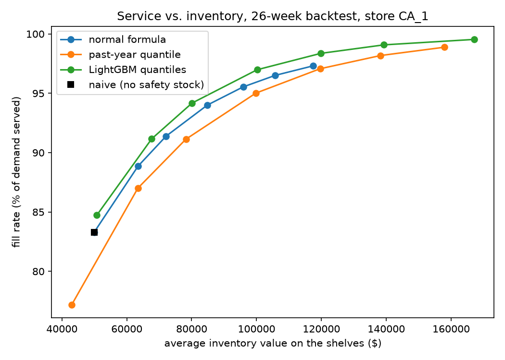
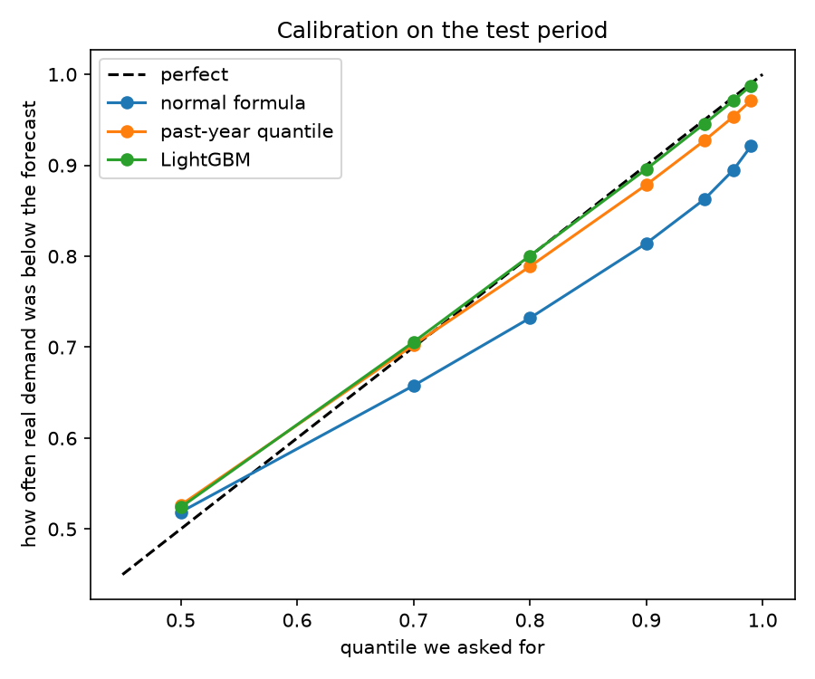

# Walmart demand forecasting for inventory decisions

Most forecasting projects stop at "my error is X". This one asks the question a store
manager actually cares about: **how much of each product should I order this week?**

It forecasts demand for about 3,000 products per Walmart store (M5 dataset), turns the
forecasts into weekly orders, and replays 26 weeks of real demand to see how each
ordering method would have done. Tested on three stores in three states.

## Results

26-week backtest on data the model never saw (Nov 2015 to May 2016). Each store has its
own model.

**Same service to customers, less money sitting on shelves.** Inventory the LightGBM
model needs, compared with the *better* of two classical methods at the same fill rate:

| Store | 90% fill rate | 95% fill rate | 97% fill rate |
|---|---|---|---|
| CA_1 (California) | 4.1% less | 6.5% less | 11.1% less |
| TX_1 (Texas) | 5.9% less | 7.1% less | 7.2% less |
| WI_1 (Wisconsin) | 6.4% less | 8.7% less | 10.6% less |

**The forecasts are honest about uncertainty.** When asked for a number that demand
should stay under 95% of the time, this is how often it actually did:

| Store | Normal formula | Past-year quantile | LightGBM |
|---|---|---|---|
| CA_1 | 86.3% | 92.7% | 94.6% |
| TX_1 | 86.8% | 93.5% | 94.7% |
| WI_1 | 86.3% | 91.5% | 94.5% |

Full numbers: [reports/store_comparison.csv](reports/store_comparison.csv)

| | |
|---|---|
|  |  |

## How it works

```
raw M5 files
   |  step1_prepare_data.py     pick one store, make a days x products table
   v
   |  step2_build_features.py   15 features per product per day + the target
   v
   |  step3_train_forecasts.py  LightGBM quantile models vs 3 baselines
   v
   |  step4_simulate_inventory.py  replay 26 weeks of weekly ordering
   v
dashboard/app.py                look at the results, product by product
```

- **What is predicted:** total units sold over the next 10 days (7 days between orders +
  3 days delivery time), because that is how long one order has to last.
- **Why quantiles:** a store doesn't want the average, it wants "a level I'll only exceed
  5% of the time". The model predicts that level directly.
- **Baselines:** (1) recent average with no safety margin, (2) the textbook
  safety-stock formula `average + z x standard deviation`, (3) the quantile of the
  product's own 10-day totals over the past year.
- **Simulation:** every week, top the stock back up to the forecast level; orders take
  3 days; if the shelf is empty the sale is lost.

## Dashboard

```bash
pip install -r requirements.txt
streamlit run dashboard/app.py
```

This works straight after cloning: the small result files it needs are in
`dashboard/data/`. Pick a store, a product and a service level and watch the simulated
shelf day by day.

## Rerun the whole pipeline

Download the M5 data ([Kaggle](https://www.kaggle.com/competitions/m5-forecasting-accuracy/data))
and put `sales_train_evaluation.csv`, `calendar.csv`, `sell_prices.csv` in `data/raw/`. Then:

```bash
python src/run_all_stores.py
```

or one store, one step at a time (`python src/step1_prepare_data.py` and so on).
About 3 minutes per store on a laptop. `pytest` runs the simulator checks.

## Honest limitations

- The data records **sales, not demand**. If Walmart's shelf was empty on a day, the
  data shows 0 even if customers wanted the product. So true demand is a bit higher
  than what is simulated here.
- Profit margin (30%) and holding cost (25% a year) are assumptions; M5 only gives
  selling prices. The inventory-vs-fill-rate comparison does not depend on them.
- Three stores, one 26-week period, fixed 3-day delivery, no pack sizes, no
  shelf-space limits, no spoilage.
- Next week's prices are used as a feature, assuming the store knows its own planned
  promotions.

More detail and explanations of every concept: [docs/LEARNING_GUIDE.md](docs/LEARNING_GUIDE.md)
